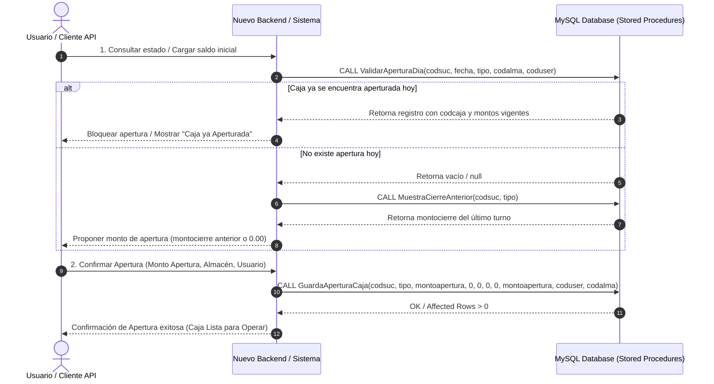

# Contrato y Flujo de Apertura de Caja (Caja Diaria / Ventas)

Este documento describe la arquitectura, la lógica de negocio y el **contrato de Base de Datos (MySQL)** para la **Apertura de Caja** del ERP **SIGEFA**, diseñado para permitir su re-implementación en cualquier nuevo sistema (Backend REST, Microservicio u otro cliente) utilizando únicamente la Base de Datos como contrato.

---

## 1. Visión General del Proceso

La apertura de caja es un prerequisito fundamental en el ERP antes de registrar cualquier venta al contado, cobro o movimiento monetario. Garantiza el control diario de fondos por **Sucursal**, **Almacén**, **Tipo de Caja** (1 = Caja Ventas / Diario, 2 = Caja Chica) y **Usuario**.

---

## 2. Contrato de Base de Datos (MySQL Stored Procedures)

El contrato del sistema legacy con la base de datos MySQL para la apertura de caja comprende los siguientes procedimientos almacenados y tablas:

### 2.1. Procedimientos Almacenados Principales

#### 1. `ValidarAperturaDia`
Verifica si existe una caja aperturada para la fecha actual, sucursal, almacén y tipo de caja.

- **Firma:** `ValidarAperturaDia(IN codsuc INT, IN fecha1 DATETIME, IN tipo_ex INT, IN codalmacen_ex INT)`
- **Parámetros:**
  - `codsuc`: Código de la sucursal.
  - `fecha1`: Fecha a consultar (generalmente `NOW().date`).
  - `tipo_ex`: Tipo de caja (`1` = Caja Ventas, `2` = Caja Chica).
  - `codalmacen_ex`: Código del almacén asociado.
- **Resultado / Columnas devueltas:**
  If exists:
  - `codcaja` (INT)
  - `montoapertura` (DECIMAL)
  - `fechaapertura` (DATETIME)
  - `estado` (TINYINT/BOOL - `1` = Abierta, `0` = Cerrada)
  - `coduser` (INT)
  - `codsucursal` (INT)
  - `totalIngreso`, `totalEgreso`, `totalVentaEfectivo`, `totalventacredito`, `totaldeposito`, `totalcheque`, `totaltarnsferencia`, `totalcobranza`, `totalDisponible`, `totalPendiente`
  - Campos adicionales: `ingreso_efectivo`, `ingreso_tarjeta`, `ingreso_transferencia`, `egreso_efectivo`

#### 2. `MuestraCierreAnterior` / `GetUltimaCajaVentas`
Obtiene los datos del cierre de la última caja registrada para arrastrar el saldo final como saldo inicial de la nueva apertura.

- **Firma (`MuestraCierreAnterior`):** `MuestraCierreAnterior(IN codsuc INT, IN tipo_ex INT)`
- **Retorno:** `montocierre` (DECIMAL)
- **Firma (`GetUltimaCajaVentas`):** `GetUltimaCajaVentas(IN codsucursal_ex INT, IN tipo_ex INT, IN codalmacen_ex INT)`
- **Retorno:** `codcaja`, `montoapertura`, `fechaapertura`, `montocierre`, `fechacierre`, `estado`, `coduser`, `codsucursal`

#### 3. `GuardaAperturaCaja` (Ejecución de Apertura)
Inserta el nuevo registro de apertura de caja diaria.

- **Firma:** `GuardaAperturaCaja(IN codsucursal_ex INT, IN tipo_ex INT, IN montoapertura_ex DECIMAL(12,4), IN montocierre_ex DECIMAL(12,4), IN totalIngreso_ex DECIMAL(12,4), IN totalEgreso_ex DECIMAL(12,4), IN totalVentaEfectivo_ex DECIMAL(12,4), IN totalDisponible_ex DECIMAL(12,4), IN codUser_ex INT, IN codalmacen_ex INT)`
- **Mapeo de Valores al Insertar Apertura:**
  - `codsucursal_ex`: ID Sucursal.
  - `tipo_ex`: `1` (Caja Ventas).
  - `montoapertura_ex`: Monto físico ingresado/confirmado en caja.
  - `montocierre_ex`: `0.00` (al aperturar aún no hay cierre).
  - `totalIngreso_ex`: `0.00`
  - `totalEgreso_ex`: `0.00`
  - `totalVentaEfectivo_ex`: `0.00`
  - `totalDisponible_ex`: Igual a `montoapertura_ex`.
  - `codUser_ex`: ID del usuario en sesión.
  - `codalmacen_ex`: ID Almacén seleccionado.

#### 4. `ActualizaApertura` (Modificación opcional)
Permite corregir el monto inicial de una caja aperturada en el día.
- **Firma:** `ActualizaApertura(IN mont DECIMAL(12,4), IN codalma INT)`

---

## 3. Estructura de la Tabla Base (`caja`)

La tabla principal donde se persisten las cajas aperturadas y cerradas es `caja`.

| Campo | Tipo MySQL | Descripción / Regla de Negocio |
| :--- | :--- | :--- |
| `codcaja` | `INT AUTO_INCREMENT PK` | Identificador único de la caja aperturada |
| `codsucursal` | `INT` | FK a `sucursal` |
| `codalmacen` | `INT` | FK a `almacen` |
| `tipo` | `INT` | `1` = Caja Ventas / Diaria, `2` = Caja Chica |
| `montoapertura` | `DECIMAL(12,4)` | Saldo inicial al abrir el turno/día |
| `montocierre` | `DECIMAL(12,4)` | Saldo final tras el cierre (`0.00` mientras esté abierta) |
| `fechaapertura` | `DATETIME` | Timestamp del momento de apertura (`NOW()`) |
| `fechacierre` | `DATETIME` | Timestamp de cierre (NULL o fecha por defecto) |
| `totalIngreso` | `DECIMAL(12,4)` | Sumatoria acumulada de ingresos |
| `totalEgreso` | `DECIMAL(12,4)` | Sumatoria acumulada de egresos |
| `totalVentaEfectivo` | `DECIMAL(12,4)` | Sumatoria acumulada de ventas al contado en efectivo |
| `totalDisponible` | `DECIMAL(12,4)` | Saldo dinámico disponible = `montoapertura + totalIngreso + totalVentaEfectivo - totalEgreso` |
| `estado` | `TINYINT(1)` | `1` = Aperturada (Activa), `0` = Cerrada |
| `coduser` | `INT` | FK a `usuario` que realizó la apertura |

---

## 4. Reglas de Negocio para Implementar en un Nuevo Sistema

Al re-implementar este módulo en una nueva tecnología (Node.js, Spring Boot, Go, Python, Laravel, etc.):

1. **Prerequisito de Transacciones (Ventas / Pagos):**
   - Antes de procesar una venta o cobro al contado (`frmCancelarPago` / `GuardaFacturaVenta`), la API **debe** consultar `ValidarAperturaDia`.
   - Si no retorna un `codcaja` activo (`estado = 1`), la operación de venta debe ser rechazada informando al usuario: *"No existe una caja aperturada para la fecha actual."*

2. **Control de Apertura Única por Turno/Día:**
   - No debe permitirse aperturar más de una caja activa simultáneamente para la combinación `(codsucursal, codalmacen, tipo, fecha)` si ya existe una con `estado = 1`.

3. **Sugerencia de Saldo Inicial:**
   - Al presentar la pantalla de apertura, llamar a `MuestraCierreAnterior(codsuc, tipo)`. Si devuelve valor, pre-cargar ese valor en el campo `montoapertura`. Si devuelve null o 0, pre-cargar `0.00`.

4. **Persistencia Atomizada:**
   - La inserción mediante `GuardaAperturaCaja` debe establecer `fechaapertura = NOW()`, `estado = 1` y `totalDisponible = montoapertura`.

---

## 5. Mapeo de Clases Legado (Referencia C# Decompilado)

Para referencia de la lógica legacy:
- **Formulario UI:** [`SIGEFA.Formularios.frmAperturaCajaDiaria`](file:///home/fulanito/development/sigefa_legacy_inverse/SIGEFA.Formularios/frmAperturaCajaDiaria.cs)
- **Servicio/Administrador:** [`SIGEFA.Administradores.clsAdmAperturaCierre`](file:///home/fulanito/development/sigefa_legacy_inverse/SIGEFA.Administradores/clsAdmAperturaCierre.cs)
- **Capa DAL MySQL:** [`SIGEFA.InterMySql.MysqlAperturaCierreCaja`](file:///home/fulanito/development/sigefa_legacy_inverse/SIGEFA.InterMySql/MysqlAperturaCierreCaja.cs)
- **Entidad DTO:** [`SIGEFA.Entidades.clsCaja`](file:///home/fulanito/development/sigefa_legacy_inverse/SIGEFA.Entidades/clsCaja.cs)
